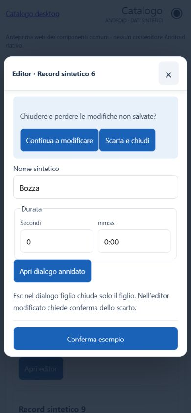
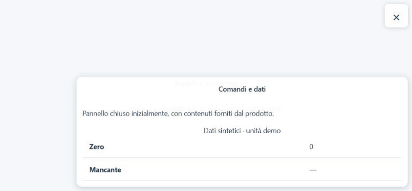

# Contratti UI Android — 0.2.8

Riallineamento del **21 ottobre 2026** alle convenzioni Fuorigiri TD-98–107, commit `30d0f0a`. I sorgenti già presenti in common e il tarball 0.2.8 fissato da Fuorigiri coincidono: non occorre rigenerare o cambiare i byte della versione consegnata per questo aggiornamento di documentazione, catalogo e verifiche.

## Contratti condivisi

Importare `theme.css`, `components.css`, `application.css` e infine gli stili specifici. Il prodotto attiva la classe `android` sull’elemento HTML quando riconosce il proprio contenitore. Il catalogo la abilita esplicitamente soltanto nell’anteprima `/?android`; non rileva né simula un dispositivo.

| Componente / classe | Contratto | Responsabilità del prodotto |
|---|---|---|
| `RecordCards` | `items` con `id`, `title`, dettagli etichettati, `onOpen`, `actionLabel`; `pageSize`, `resetKey`, `pageIndex`, `onPageChange`, locale IT/EN. Paginazione controllata o interna; pagina limitata ai record rimasti. Zero e mancanti rimangono distinti. | Filtrare i record, conservare pagina/filtri al ritorno, azzerare la pagina al cambio filtro nella modalità controllata. |
| `CollapsibleFilters` | `label` e `children`, contenitore nativo details/summary. | Conteggio e criteri dei filtri, senza perdere valori alla chiusura. |
| `FormActions` | Azioni originali, sticky nell’editor Android. | Form e submit nativi, validazione e salvataggio; niente pulsanti clonati. |
| `Dialog` | `title` accessibile, locale, focus, sfondo inerte, cancel confinato al dialogo attivo, `editor` per conferma scarto e `busy` per blocco chiusura. `fullscreen` elimina la fascia visiva del titolo, mantiene X e nome accessibile. | Dirty state di dominio e successo del salvataggio; Back nativo deve rispettare la pila e i modi attivi. |
| `TimeInput` | Secondi/null nelle proprietà, formato mm:ss e secondi; zero non diventa vuoto. | Unità e vincoli del dominio, persistenza in secondi. |
| `LoadingState` | `title`, `detail`, eventuali `retry` e `retryLabel`; status per attesa, alert e pulsante per errore recuperabile. | Fase reale, tentativo e dati conservati; nessuna percentuale inventata. |
| `ChartFrame` | `label`, `children`, `tools`, `toolsAfter`, `wide`, `fullscreen`; solo superficie e posizione dei comandi. | Motore differito, serie/unità, tabella accessibile, modi Scorri/Esplora/Zoom e ripristino. |
| `FloatingPanel` | `label`, `children`, pannello details chiuso inizialmente. | Comandi, istruzioni/dati e priorità di Back sul pannello aperto. |
| `.brand.brand-end` | Marchio in riga, giustificato a destra, testo allineato a destra. | Ordine DOM: testo/tagline prima dell’icona, che rimane a destra. Nome e icona sono del prodotto, non branding societario. |

La densità Android riduce spaziature preservando i controlli tattili. Il minimo CSS di 48 px va verificato in dp e con testo ingrandito sul contenitore effettivo. Nei moduli, gli input numerici non negativi ricevono una tastiera numeric/decimal solo se non hanno già inputMode; non forzare il comportamento sui campi con segno. Insets, IME e TalkBack richiedono prove native.

## Convenzioni di prodotto recepite

- Hamburger a sinistra e marchio a destra nella testata Android Fuorigiri; niente freccia Back duplicata. Info contiene versione e attribuzioni, anche senza società.
- Back: sistema/tastiera, modo Esplora/Zoom, pannello grafico, ultimo dialogo con cancel e conferma scarto, cronologia del prodotto, uscita alla radice. La cronologia conserva identificatori e stato UI, mai copie degli archivi.
- Coppia archivio/società persistente e riconciliata con inventario/permessi; assenza della società ricordata richiede scelta esplicita. Questa persistenza non appartiene al common UI.
- Scorri pagina predefinito anche in vista ampia. Comandi sotto il grafico normale, pannello richiamabile in fullscreen; motore caricato quando la figura è visibile e alternativa tabellare con mancanti e unità.
- Orientamento landscape e barre immersive sono richieste temporanee del bridge prodotto, con ripristino alla chiusura, smontaggio e reload. Nessuna rotazione CSS né modifica globale dell’orientamento nel common.

La [guida Android canonica](ANDROID_BEST_PRACTICES.md) conserva procedure, sicurezza e gate. Non trasferire runtime Kotlin/Chaquopy, API, storico di navigazione, formule o autorizzazioni nella libreria React.

## Verifica ripetibile

Da common: `npm test`, `npm run build`, `npm run dev`, poi aprire `http://127.0.0.1:8782/?android`.

1. Nell’elenco avanzare pagina, aprire un editor e chiuderlo: la pagina controllata resta selezionata. Cambiare filtro: ritorno alla prima pagina. Controllare zero e mancanti.
2. Modificare il nome, aprire il figlio e premere Esc: chiude soltanto il figlio. Un altro Esc chiede conferma di scarto nell’editor. Verificare anche validazione required e azione originale del form.
3. Aprire fullscreen: niente fascia titolo visibile, nome accessibile e X presenti. Il pannello è chiuso inizialmente; aprirlo per vedere i dati sintetici. Esc chiude la superficie. Il demo non implementa le priorità Back native o i modi Plotly.
4. Verificare anche larghezze ridotte e landscape nel browser. Queste prove non certificano orientamento, barre di sistema, tastiera Android, TalkBack, APK o telefono ARM64.

Allineamento dei consumatori: `npm run sync:ui -- --app ../club-lab --app ../performance-lab --app ../training-lab --check`. Consumare il pacchetto non implica un'adozione Android nell'app.

## Limiti delle prove web

- Le prove del catalogo non sostituiscono build APK, IME, TalkBack o telefono.
- Esc ripetuti dopo la chiusura di un dialogo figlio vanno verificati su WebView/emulatore: in automazione browser il comportamento non è risultato conclusivo. Non dichiarare superato il Back Android sulla base del solo catalogo.

Le catture seguenti provengono dal catalogo web con dati inventati, **non** da un emulatore o da Fuorigiri. Aggiornarle insieme a modifiche delle relative viste; conservare formato, provenienza e dimensioni effettive.

